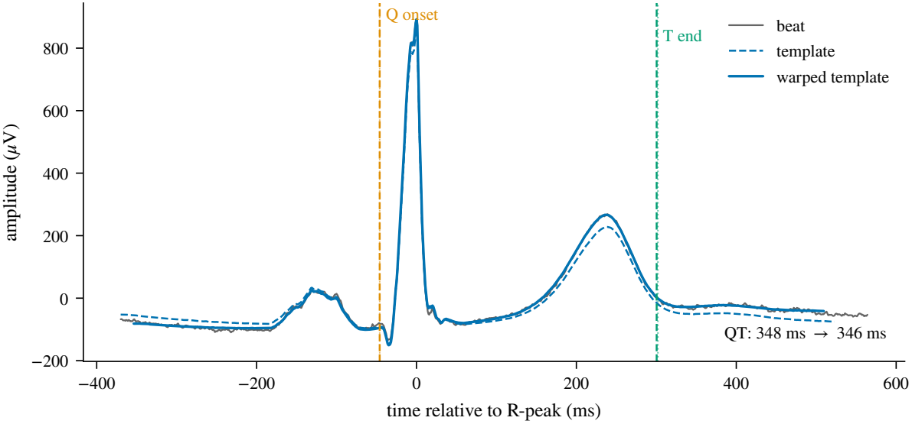
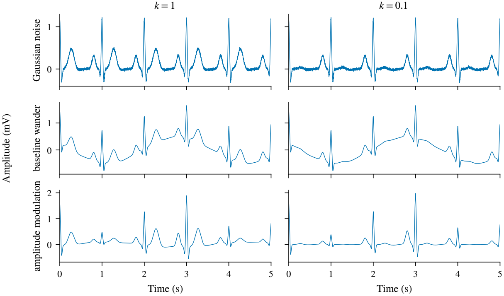
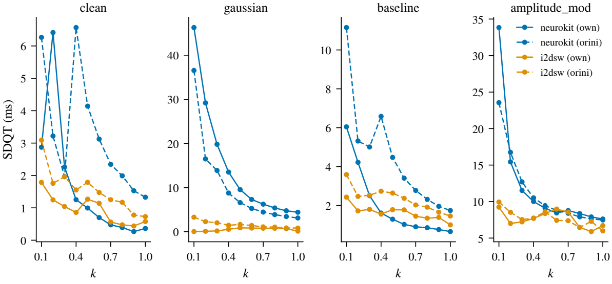

# QT Variability from Ultra-Short ECGs

Code and results of my bachelor thesis **"Setup and Evaluation of Algorithms for
Ultra-Short-Term QT Interval Variability Analysis"**: Chair for Diagnostic
Sensing, Institute of Computer Science, University of Augsburg, 2026.

The thesis compares two ways of measuring QT variability (QTV) on 10–30 s ECG
segments inside one shared pipeline: the **NeuroKit2** wavelet delineator as a
toolbox baseline, and the warping-based **iterative two-dimensional signal
warping (i2DSW)** of Schmidt et al.

> **Note:** the i2DSW core algorithm is not included in this repository (see
> [below](#i2dsw-implementation)). Everything around it is: preprocessing,
> template construction, fiducial estimation, beat rejection, metrics, the
> synthetic data generator, the evaluation runners and the analysis notebooks.

## Abstract

QT interval variability (QTV) quantifies the fluctuations in repolarization time
between heartbeats and has been proposed as a risk marker for cardiovascular
disease. Clinical application has so far been limited by the required ECG
recording duration, as several hundred seconds of signal are recommended,
whereas a standard resting ECG lasts 10 s and recordings from typical wearable
devices last about 30 s. In addition, the algorithmic estimation is challenging.
There is no established methodology for such ultra-short segments, and QT
estimation approaches based on warping have not been tested for this duration.

This work implements a pipeline and compares two approaches: a wavelet
delineator from NeuroKit2 as a freely available toolbox baseline, and the
iterative two-dimensional signal warping algorithm (i2DSW) as a warping-based
method. Both are evaluated on synthetic signals with a known QTV of zero, on the
PTB Diagnostic ECG Database (myocardial infarction vs. healthy controls), and on
SJLIFE, which links Apple Watch and clinical Lead I recordings from the same
subjects.

For distorted synthetic signals, i2DSW is considerably more accurate. For real
ultra-short segments, it reproduces published reference values (median SDQT of
2.31 ms at 10 s in healthy subjects), whereas the NeuroKit2 values exceed the
i2DSW values and lie well outside the reference ranges. Group separation remains
significant for both approaches on 15 s recordings. The absolute QTV values
depend heavily on segment length, so reference values are length-specific. The
agreement between recordings from wearables and clinical recordings is weak or
entirely absent.

## Method

Both paths share the same preprocessing (high-pass filter, QRS detection, beat
alignment) and the same metric calculation (SDQT, SDRT, QTVi), so they differ
only in how the QT interval of each beat is measured.

- **NeuroKit2**: per-beat Q-onset and T-end from the wavelet delineator.
- **i2DSW**: a template beat is built from mutually similar beats, its Q-onset
  and T-end are estimated once, and the template is then warped in time *and*
  amplitude onto every beat. The QT interval is read off the warped template.
  Beats the template cannot be adapted to are rejected.



*i2DSW: template (dashed) warped onto one PTB beat (solid); QT is read at the
warped fiducials.*

## Datasets

| Dataset | Purpose |
| --- | --- |
| Own synthetic set | One clean beat tiled to a known QTV of 0, T-wave amplitude scaled by `k`, with Gaussian noise / baseline wander / amplitude modulation. Any SDQT > 0 is a measurement error. |
| Synthetic set by Schmidt et al. | Same idea, 360 s recordings, for comparison with published i2DSW values. |
| PTB Diagnostic ECG Database | Myocardial infarction (MI) vs. healthy controls, segments of 10 / 15 / 30 / 60 s and full length (~116 s). |
| SJLIFE | Paired Apple Watch and clinical Lead I recordings of the same subjects (10 s). |



## Key results

**Synthetic data (true QTV = 0, 15 s).** Mean SDQT in ms, averaged over all
T-wave amplitudes `k` and 10 seeds (custom filter):

| Condition | NeuroKit2 | i2DSW |
| --- | ---: | ---: |
| Clean | 1.60 | 0.94 |
| Gaussian noise | 14.64 | **0.49** |
| Baseline wander | 1.99 | 1.62 |
| Amplitude modulation | 12.10 | 7.61 |



**PTB: median SDQT in ms** (custom filter):

| Method | Group | 10 s | 15 s | 30 s | 60 s | full |
| --- | --- | ---: | ---: | ---: | ---: | ---: |
| i2DSW | MI | 3.52 | 4.08 | 4.86 | 5.44 | 5.67 |
| i2DSW | Healthy | **2.31** | 2.57 | 3.05 | 3.04 | 3.43 |
| NeuroKit2 | MI | 20.67 | 21.91 | 23.25 | 23.47 | 24.67 |
| NeuroKit2 | Healthy | 6.45 | 8.03 | 9.02 | 9.13 | 9.39 |

- i2DSW matches published normal values (van den Berg et al.: 2.14–2.79 ms at
  10 s; Baumert et al.: 3.3 ms for longer recordings). NeuroKit2 is 2–4× higher.
- MI vs. healthy stays significant at 15 s for both methods (Mann-Whitney U,
  p = 3.8 × 10⁻⁴ for i2DSW, p = 8.7 × 10⁻⁷ for NeuroKit2).
- SDQT depends strongly on segment length (Friedman p = 7.5 × 10⁻²⁸ for i2DSW),
  but 15 s and full-length values correlate well (Spearman ρ = 0.77). Reference
  values therefore have to be length-specific.

**SJLIFE (10 s, Lead I).** On clinical recordings i2DSW again reproduces normal
values (median SDQT 2.02 ms, QTVi −1.66). On the Apple Watch recordings of the
same subjects it is much higher (8.83 ms), and the per-subject correlation of
SDQT between the two sources is not significant (ρ = 0.12).

**Runtime.** NeuroKit2 takes ~0.1 s per record. i2DSW takes a median of ~10 s
for a 10 s segment, growing slightly faster than linearly with length.

## Repository layout

```
src/pipeline/   pipeline stages, dataset-independent
  loaders.py        PTB, Schmidt et al. synthetic and SJLIFE loaders -> uniform Record
  preprocessing.py  filtering, QRS detection, beat alignment, beat extraction
  template.py       i2DSW template construction and fiducial estimation
  qtv_i2dsw.py      i2DSW path: warp template onto every beat, read QT / RT
  qtv_neurokit.py   NeuroKit2 path: per-beat QT / RT from the delineator
  metrics.py        beat rejection, SDQT, SDRT, QTVi
  synthetic.py      synthetic zero-QTV ECG generator
src/runners/    one evaluation driver per dataset, each writes a CSV to results/
src/tests/      filter parameter sweep, manual PTB record review, plot style
src/kammler/    placeholder for the i2DSW implementation (not included)
notebooks/      statistics and figures per evaluation
results/        result CSVs used in the thesis
```

## Running

Python ≥ 3.13, managed with [uv](https://docs.astral.sh/uv/):

```bash
uv sync
uv run python -m src.runners.run_synthetic      # needs no external data
```

The notebooks in `notebooks/evaluation/` analyse the committed result CSVs and
run on the project environment's kernel (e.g. from VS Code or PyCharm).

The PTB, Schmidt et al. and SJLIFE runners expect the datasets under `data/`,
which is not distributed. PTB is available from
[PhysioNet](https://physionet.org/content/ptbdb/); SJLIFE is access-controlled.
The SJLIFE result table is not published for that reason.

## i2DSW implementation

The i2DSW algorithm (Schmidt et al. 2014, 2018) was used through a Python
implementation by L. Kammler (2025) that is not part of this repository.
`src/kammler/i2DSW.py` only holds its interface. Without it, the runners
evaluate the NeuroKit2 path only, and calling the i2DSW path raises a clear
error. All i2DSW results in `results/` and in the notebooks come from the
full implementation.

## References

- M. Schmidt et al., "Two-Dimensional Warping for One-Dimensional Signals — Conceptual Framework and Application to ECG Processing," *IEEE Trans. Signal Process.*, 2014. doi:10.1109/TSP.2014.2354313
- M. Schmidt et al., "Iterative two-dimensional signal warping — Towards a generalized approach for adaption of one-dimensional signals," *Biomed. Signal Process. Control*, 2018. doi:10.1016/j.bspc.2018.03.016
- D. Makowski et al., "NeuroKit2: A Python toolbox for neurophysiological signal processing," *Behav. Res. Methods*, 2021. doi:10.3758/s13428-020-01516-y
- M. Baumert et al., "QT interval variability in body surface ECG: measurement, physiological basis, and clinical value," *Europace*, 2016.
- M. E. van den Berg et al., "Normal Values of QT Variability in 10-s Electrocardiograms for all Ages," *Front. Physiol.*, 2019. doi:10.3389/fphys.2019.01272
- R. D. Berger et al., "Beat-to-beat QT interval variability," *Circulation*, 1997. doi:10.1161/01.cir.96.5.1557
- M. Orini et al., "Ultra-Short Beat-to-Beat Repolarization Variability Predicts Cardiovascular Events in Individuals Without Cardiovascular Disease," *CinC*, 2023. doi:10.22489/CinC.2023.178

## License

© 2026 Noah Bridgeman. All rights reserved.
